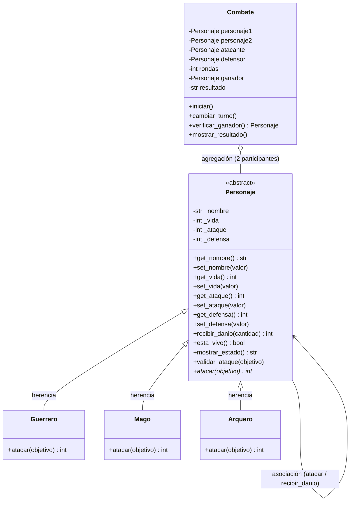

# Guardians of the Ancient Kingdom

## 1. Descripción

Guardians of the Ancient Kingdom es un juego de combate por turnos hecho en Python con programación orientada a objetos. Dos guardianes del reino de Eldoria (Guerrero, Mago o Arquero) se atacan por turnos hasta que uno se queda sin vida, y el programa dice quién ganó o si el combate terminó en empate.

El problema que resuelve es manejar personajes que comparten datos (nombre, vida, ataque y defensa) pero atacan de forma distinta, sin repetir código y sin que el combate tenga que saber qué tipo de personaje es cada uno.

## 2. Estructura

- `personajes.py`: contiene todas las clases del juego. No ejecuta nada al importarse.
- `main.py`: crea los personajes, ejecuta los casos de prueba y los combates, mostrando los resultados en pantalla.
- `test_personajes.py`: pruebas automatizadas con Pytest (reto extra).
- `README.md`: este documento.

## 3. Clases

- **Personaje**: clase base abstracta. Guarda nombre, vida, ataque y defensa con validaciones, y sabe recibir daño, decir si está vivo y mostrar su estado. Obliga a cada hijo a implementar `atacar()`.
- **Guerrero**: su ataque sube un 20 % antes de restarle la defensa al enemigo.
- **Mago**: su ataque ignora la defensa del enemigo.
- **Arquero**: si su ataque es mayor que la defensa del enemigo, hace el doble de daño.
- **Combate**: controla los turnos, revisa si hay ganador y muestra el resultado. Recibe dos personajes que ya fueron creados.

## 4. Relaciones

- **Herencia**: Guerrero, Mago y Arquero *son* Personajes. Se usó para no repetir los atributos ni `recibir_danio()` en cada clase.
- **Asociación**: cuando un personaje ataca a otro, los dos objetos interactúan: el atacante llama a `recibir_danio()` del objetivo. Ninguno es dueño del otro.
- **Agregación**: Combate *tiene* dos personajes, pero no los crea; se crean aparte en `main.py` y siguen existiendo aunque el combate termine.

## 5. Conceptos de POO

- **Abstracción**: `Personaje` define que todos deben poder atacar, pero no cómo lo hace cada uno.
- **Encapsulamiento**: los atributos (`_vida`, `_ataque`, etc.) son internos y solo se cambian con los `set_`, que validan. Por eso es imposible crear un personaje con vida 101 o nombre vacío.
- **Herencia**: las subclases reutilizan el constructor, los getters y setters y `recibir_danio()`.
- **Polimorfismo**: `Combate` llama a `atacar()` sin preguntar si es Guerrero, Mago o Arquero, y cada uno responde con su propia fórmula.

## 6. Lógica del combate

Fórmulas de daño:

- **Guerrero**: `ataque × 1.20 − defensa` (redondeado hacia abajo, mínimo 0).
- **Mago**: el daño es igual a su ataque.
- **Arquero**: `(ataque − defensa) × 2` si el ataque supera la defensa; si no, 0.

Turnos: el primer personaje ataca y luego el segundo; esos dos ataques forman una ronda. `cambiar_turno()` intercambia quién ataca y quién defiende. Después de cada ataque se muestra la vida de los dos.

El combate termina cuando:

1. Un personaje llega a 0 de vida: gana el otro.
2. Una ronda completa no causa daño: empate técnico.
3. Se completan 50 rondas sin ganador: empate.

## 7. Ejecución

1. Descargar el repositorio con **Code > Download ZIP** y descomprimirlo (o clonarlo con `git clone`).
2. Abrir una terminal dentro de la carpeta del proyecto.
3. Ejecutar el programa:

```bash
python main.py
```

4. Para correr las pruebas automáticas (necesita Pytest: `pip install pytest`):

```bash
pytest test_personajes.py -v
```

## 8. Pruebas

Al ejecutar `main.py` se comprueba lo siguiente. Las pruebas de validación crean personajes con datos malos y verifican que se lance `ValueError`.

1. Creación de un Guerrero (Aragorn), un Mago (Merlín) y un Arquero (Robin).
2. Vida 101 y vida -5 son rechazadas.
3. Nombre vacío es rechazado.
4. Ataque 0 y defensa -1 son rechazados.
5. **Guerrero**: ataque 36 contra defensa 10 causa 33 de daño.
6. **Mago**: ataque 45 contra defensa 25 causa 45 de daño.
7. **Arquero**: ataque 38 contra defensa 14 causa 48 de daño.
8. La vida no baja de 0: con 20 de vida y 50 de daño queda en 0.
9. Un personaje derrotado no puede atacar ni ser atacado.
10. Combate completo entre Aragorn (Guerrero) y Merlín (Mago).
11. Con esas estadísticas gana Aragorn con 19 de vida restante.
12. Dos personajes que no se hacen daño terminan en empate técnico.

---

## Reto extra 1: Diagrama de clases UML

Un diagrama de clases UML es un dibujo que muestra las clases de un programa, qué atributos y métodos tiene cada una y cómo se relacionan. Sirve para entender la arquitectura antes (o después) de programar.



**Explicación:** `Personaje` está marcada como abstracta y su método `atacar()` tiene un asterisco porque es abstracto. Las tres flechas de herencia muestran que Guerrero, Mago y Arquero heredan de ella y cada uno implementa su propio `atacar()`. El rombo vacío entre `Combate` y `Personaje` es la agregación: el combate usa dos personajes que existen por separado. La flecha de `Personaje` hacia sí misma es la asociación: un personaje interactúa con otro al atacarlo.

## Reto extra 2: Pruebas automáticas con Pytest

Pytest es una herramienta de Python que ejecuta pruebas automáticamente. En vez de correr el programa y revisar los mensajes a ojo, cada prueba usa `assert` para comprobar que el resultado es el esperado, y si algo falla, Pytest lo avisa. Así se puede repetir todas las pruebas en segundos cada vez que se cambia el código.

Las pruebas están en `test_personajes.py` y cubren: creación de personajes válidos, rechazo de valores incorrectos, daño de cada clase, vida nunca negativa, derrotado que no puede atacar y resultado de los combates (incluyendo el ejemplo del enunciado donde gana Gandalf y el empate técnico).

Comando:

```bash
pytest test_personajes.py -v
```

Resultado de la ejecución:

```text
collected 17 items

test_personajes.py::test_creacion_personajes_validos PASSED              [  5%]
test_personajes.py::test_vida_invalida[101] PASSED                       [ 11%]
test_personajes.py::test_vida_invalida[-5] PASSED                        [ 17%]
test_personajes.py::test_nombre_vacio PASSED                             [ 23%]
test_personajes.py::test_ataque_invalido PASSED                          [ 29%]
test_personajes.py::test_defensa_invalida PASSED                         [ 35%]
test_personajes.py::test_dano_guerrero PASSED                            [ 41%]
test_personajes.py::test_dano_mago_ignora_defensa PASSED                 [ 47%]
test_personajes.py::test_dano_arquero_critico PASSED                     [ 52%]
test_personajes.py::test_arquero_sin_dano_si_ataque_no_supera_defensa PASSED [ 58%]
test_personajes.py::test_vida_nunca_negativa PASSED                      [ 64%]
test_personajes.py::test_danio_negativo_rechazado PASSED                 [ 70%]
test_personajes.py::test_derrotado_no_puede_atacar PASSED                [ 76%]
test_personajes.py::test_no_se_puede_atacar_a_un_derrotado PASSED        [ 82%]
test_personajes.py::test_combate_con_ganador PASSED                      [ 88%]
test_personajes.py::test_combate_ejemplo_del_enunciado_gana_gandalf PASSED [ 94%]
test_personajes.py::test_empate_tecnico PASSED                           [100%]

============================== 17 passed ==============================
```

## Reto de abstracción

**¿Por qué `atacar()` es abstracto pero `recibir_danio()` está implementado en la clase base?**

La clase `Personaje` tiene la responsabilidad de guardar lo que todos los guardianes tienen en común (nombre, vida, ataque y defensa) y de definir qué cosas debe poder hacer cualquiera de ellos. Eso incluye dos acciones: atacar y recibir daño. Pero esas dos acciones no se comportan igual de general.

**`recibir_danio()` es igual para todos.** Un Guerrero, un Mago y un Arquero pierden vida exactamente de la misma forma: se rechaza el daño negativo, se resta de la vida, la vida nunca baja de 0 y se devuelve el daño real recibido. Como la lógica es idéntica, se escribe una sola vez en `Personaje` y las tres subclases la reutilizan por herencia. Si estuviera repetida en cada clase, un cambio (por ejemplo, otra regla para la vida) habría que hacerlo tres veces. Además, el daño ya llega calculado, así que esta función no necesita saber quién atacó.

**`atacar()` es distinto en cada uno.** Cada clase tiene su propia habilidad: el Guerrero multiplica su ataque por 1.20 y le resta la defensa, el Mago hace daño igual a su ataque ignorando la defensa, y el Arquero duplica el daño si su ataque supera la defensa. No existe una forma "general" de atacar que sirva para los tres, así que `Personaje` no puede darla. Lo que sí puede hacer es obligar a que cada hija la defina, y eso se logra con `@abstractmethod`. Así nadie puede crear un personaje que no sepa atacar, y tampoco se puede crear un `Personaje` genérico, porque está incompleto.

**Relación con los conceptos de POO:**
- **Abstracción:** `Personaje` dice *qué* debe poder hacer un guardián (atacar), sin decir *cómo*.
- **Herencia:** `recibir_danio()`, los getters y los setters se escriben una vez y se heredan.
- **Polimorfismo:** como todos tienen `atacar()`, la clase `Combate` hace `self.atacante.atacar(self.defensor)` sin preguntar si es Guerrero, Mago o Arquero, y cada uno ejecuta su propia fórmula. Gracias a esto se podría agregar un nuevo guardián (por ejemplo, un Sanador) solo creando una clase hija con su `atacar()`, sin tocar `Combate`.
